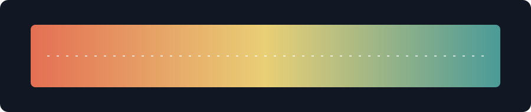

# Gradient Atlas

A compact color laboratory for composing CSS gradients without a wall of controls.



## Features
- Tune the angle and three color stops.
- Preview the gradient on a large surface.
- Export a standards-based `linear-gradient()` declaration.
- No framework, account or network request.

## Run & test
Open `index.html` locally. Node.js 18+ runs the pure-function suite:

```bash
node --test tests.mjs
```

## Scope
This release focuses on linear gradients with six-digit hex colors and percentage stops. It does not export image files or guarantee contrast for text placed over a gradient.

## Design
A dark observatory palette lets the gradient itself become the main event. Hero motion is decorative and reduced-motion aware.

## License
MIT.
